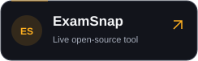
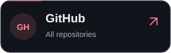
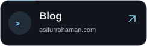
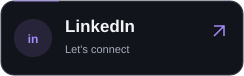
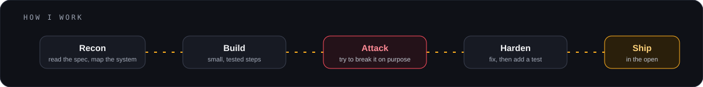

  

<h1 align="center">Hey, I'm Asif.</h1>

<strong>AI Security &amp; Safety · Machine Learning · Offensive Security</strong> 
B.Tech IT student · India · IST (UTC+5:30) · Open to research &amp; engineering internships

  <a href="https://asifurrahaman.com"><strong>Blog</strong></a> &nbsp; / &nbsp;
  <a href="https://www.linkedin.com/in/asifur-rahaman-dev/"><strong>LinkedIn</strong></a> &nbsp; / &nbsp;
  <a href="https://x.com/Asif64077466"><strong>X</strong></a> &nbsp; / &nbsp;
  <a href="mailto:asif@asifurrahaman.com"><strong>Email me</strong></a>

  
  
  
  

I build machine-learning systems and then try to break them. My focus is **AI security and safety**: how agents and models fail under attack, and how to make them fail less. I work mostly in **Python**, with **FastAPI**, **React/Next.js** and **Linux** around it, and I like shipping things in the open.

### By the numbers

Stars, contributions and streaks, pulled live from GitHub. Mostly here to keep me honest about shipping.

  <picture>
    <source media="(prefers-color-scheme: dark)" srcset="https://github-readme-stats.vercel.app/api?username=GeekyAsif786&show_icons=true&include_all_commits=true&hide_border=true&theme=github_dark&bg_color=00000000" />
    <source media="(prefers-color-scheme: light)" srcset="https://github-readme-stats.vercel.app/api?username=GeekyAsif786&show_icons=true&include_all_commits=true&hide_border=true&bg_color=00000000" />
    
  </picture>
  <picture>
    <source media="(prefers-color-scheme: dark)" srcset="https://streak-stats.demolab.com?user=GeekyAsif786&theme=dark&hide_border=true&background=00000000" />
    <source media="(prefers-color-scheme: light)" srcset="https://streak-stats.demolab.com?user=GeekyAsif786&theme=default&hide_border=true&background=00000000" />
    
  </picture>

### A few things about me

- **Research:** working on **ToolsetSentinel**, toolset-level detection of distributed and implicit **tool poisoning in MCP agents** (paper in progress).
- **Open source:** maintainer of **[ExamSnap](https://github.com/GeekyAsif786/ExamSnap)**, a privacy-first exam photo & signature resizer for Indian students. Contributions welcome, and there are [good first issues](https://github.com/GeekyAsif786/ExamSnap/labels/good%20first%20issue).
- **Security:** offensive-security home lab; I read code the way an attacker would.
- **Education:** B.Tech in Information Technology, 3rd year.
- **Side interests:** IoT and robotics.

### Selected work

| Project | What it is | Engineering focus |
| :--- | :--- | :--- |
| **[ExamSnap](https://github.com/GeekyAsif786/ExamSnap)** · [live](https://examsnap.asifurrahaman.com) | Resizes exam photos and signatures to the exact pixels and KB Indian portals require, 100% in the browser. Hindi UI, works offline. | **Vanilla JS · PWA · Playwright** — JPEG byte-range fitting, metadata stripping, strict CSP, CodeQL, three-engine e2e tests. |
| **[SentinelAI](https://github.com/GeekyAsif786/sentinelAI)** | Defensive security tool that turns Nmap scans into AI-assisted attack-path analysis. | **Python · Nmap · Neo4j · Celery** — XML and live scan ingestion, graph-based attack paths. |
| **Veritas-Engine**<!-- TODO: add repo link --> | AI research engine that produces defensible, traceable research reports. | **FastAPI · Next.js** — multi-phase pipeline built in 20 planned phases. |
| **[RoadMind](https://github.com/GeekyAsif786/RoadMind)** | Hardware + software road-traffic signal optimiser and controller. | **XGBoost · OpenCV · FastAPI · PostgreSQL · React** — vision-based traffic counting and ML-driven signal timing. |
| **[clip-cast](https://github.com/GeekyAsif786/clip-cast)** | Full-stack video streaming platform. | **MERN** — uploads, streaming and user flows end to end. |

### Tools I work with

| Area | Tools and methods |
| :--- | :--- |
| **AI & ML** | Python, scikit-learn, XGBoost, OpenCV, LLM agents, MCP |
| **Security** | Nmap, Linux, Bash, offensive security, threat modelling, CodeQL |
| **Applications** | FastAPI, React, Next.js, Node.js, MERN, JavaScript, C/C++ |
| **Data & delivery** | PostgreSQL, Neo4j, Docker, Git, GitHub Actions, Playwright |

### Contribution visualizer

A snake making its way through my GitHub contributions. Refreshed daily.

<picture>
  <source media="(prefers-color-scheme: dark)" srcset="https://raw.githubusercontent.com/GeekyAsif786/GeekyAsif786/output/github-snake-dark.svg" />
  <source media="(prefers-color-scheme: light)" srcset="https://raw.githubusercontent.com/GeekyAsif786/GeekyAsif786/output/github-snake.svg" />
  
</picture>

### Let's build something secure

**Working on AI security, ML or open-source tooling?** I'd love to hear about it, whether it's an internship, a research idea or a bug you want a second pair of eyes on.

[**Email techwise.asif.dev@gmail.com →**](mailto:techwise.asif.dev@gmail.com) &nbsp; · &nbsp; [Connect on LinkedIn](https://linkedin.com/in/asifur-rahaman-0a986b1a6) &nbsp; · &nbsp; [Read my blog](https://asifurrahaman.com)
